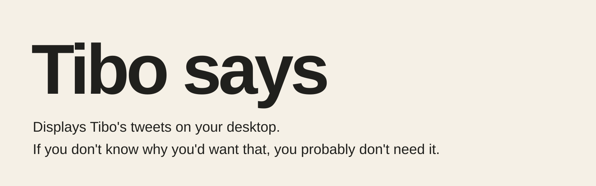
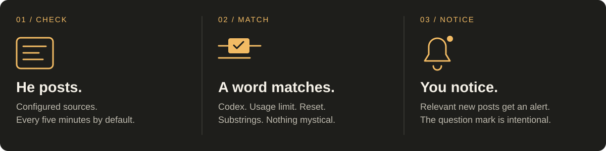

<p align="center">
  
</p>

<h1 align="center">Tibo Says</h1>
<p align="center">Displays Tibo's tweets on your desktop.<br>If you don't know why you'd want that, you probably don't need it.</p>
<p align="center">Windows · Python 3.9+ · Standard library · Unofficial</p>
<p align="center">
  <a href="#run-it">Run it</a> &nbsp; / &nbsp;
  <a href="#what-it-does">What it does</a> &nbsp; / &nbsp;
  <a href="#settings">Settings</a> &nbsp; / &nbsp;
  <a href="#if-nothing-happens">If nothing happens</a>
</p>

---

Sometimes [Tibo](https://x.com/thsottiaux) says something about free Codex usage resets. I would like to know when that happens without opening X.

That's the app.

## What it does



| The feature | The extent of the feature |
| :--- | :--- |
| **A little window** | Posts and replies from `@thsottiaux`, with clickable links to the originals. |
| **Regular checking** | Every five minutes by default. **Refresh** requests another check. |
| **Keyword highlighting** | Words such as `Codex`, `usage limit`, and `reset` get your attention. |
| **A noise** | Relevant new posts trigger a sound. Hot keywords get the stronger alert. Sound can be turned off. |
| **A `RESET?` badge** | The default hot keyword is `reset`. A matching new post also brings the window forward. |
| **A memory** | Keeps recent posts and read state between launches. The first successful fetch establishes a baseline without sounding alerts. |
| **A pin** | Keeps the window on top. An ambitious feature, but we managed. |

> **`RESET?` means a word matched.** It does not confirm a reset, inspect your Codex account, or change your limits. It displays tweets. Very advanced stuff.

## Run it

### With Python

1. Install **Python 3.9 or newer** for Windows, including **Tkinter** and the **Python launcher**. The installer from [python.org](https://www.python.org/downloads/windows/) provides these components.
2. [Download the source ZIP](https://github.com/JinParkmida/Tibo-Says/archive/refs/heads/main.zip) and extract it.
3. Double-click **`tibo_says.pyw`**.

If Windows has opinions about file associations, open a terminal in the extracted folder and run:

```powershell
py tibo_says.pyw
```

The app uses only Python's standard library. There is no `pip install` step to run it.

### As an executable

Run **`build.bat`** from the extracted project folder. It installs or upgrades **PyInstaller**, then builds:

```text
dist\Tibo says.exe
```

The resulting app runs without a console window. Building requires Python, the Python launcher, and an internet connection to install PyInstaller. The build script waits for a keypress at the end.

**The repository contains source, not a prebuilt `.exe`.** The executable is something you build locally. A small amount of assembly required.

## Settings

Click **Settings** in the app. It opens:

```text
%APPDATA%\TiboSays\config.json
```

Edit the JSON, save it, and click **Refresh**. Settings are reloaded at the start of the next check; a check already in progress needs to finish first.

| Setting | Default | What it changes |
| :--- | :--- | :--- |
| `poll_minutes` | `5` | Delay between completed checks. Minimum: one minute. |
| `keywords` | Includes `codex`, `usage limit`, `reset` | Case-insensitive substring matches for highlighting and sound. |
| `hot_keywords` | `["reset"]` | Adds `RESET?`, uses the stronger sound, and brings new matching posts forward. |
| `sound` | `true` | Enables keyword alert sounds. Also available in the window. |
| `always_on_top` | `false` | Pins the window. Also available in the window. |
| `include_replies` | `true` | Includes replies returned by the configured sources. |
| `max_tweets` | `40` | Maximum number of recent posts kept in the app. |

For example, change these entries **in the existing file** to check less often and stay quiet:

```json
{
  "poll_minutes": 10,
  "sound": false,
  "always_on_top": true
}
```

Keep the rest of your settings. JSON does not appreciate comments or trailing commas.

### Where posts come from

The app checks its configured sources and merges posts by ID:

| Source | Configuration | What to expect |
| :--- | :--- | :--- |
| **Public RSS feeds** | `rss_urls` | Tries URLs in order until one returns posts. `{user}` expands to the configured username. |
| **X syndication page** | `use_x_page_source` | Enabled by default. Depends on a public endpoint and its response format. |
| **X API** | `x_bearer_token` or `X_BEARER_TOKEN` | Optional. Requires your own bearer token with suitable read access. |

**Public sources can fail, disappear, or return incomplete results.** Replies depend on what each source exposes. The app cannot display a post it did not receive. The status line shows which sources responded.

If using an API token, the `X_BEARER_TOKEN` environment variable keeps it out of the settings file. A nonempty `x_bearer_token` in the file takes precedence. Keep tokens private; do not put them in this repository or in issue screenshots.

## If nothing happens

| What you see | What to do |
| :--- | :--- |
| **The window never opens** | Run `py tibo_says.pyw` in a terminal to see the error. Check that your Python installation includes Tkinter. |
| **No posts / sources marked `✗`** | Check your connection, then update `rss_urls` to a working feed or configure your own X API access. Click **Refresh**. |
| **Old posts, no new ones** | Cached posts stay visible. Check the source indicators before assuming Tibo has become quiet. |
| **No sound on first launch** | Expected. The first successful fetch establishes the baseline; it does not announce the entire back catalogue. |
| **No sound later** | Check **Sound on**, your Windows volume, and whether a newly received post actually matches a keyword. |
| **`RESET?`, but no reset** | A substring matched. The question mark is doing its job. |

Local files live in `%APPDATA%\TiboSays\`:

| File | Contents |
| :--- | :--- |
| `config.json` | Settings, including a bearer token if you chose to store one there. |
| `state.json` | Cached posts, seen IDs, unread state, window size, and position. |
| `error.log` | Unhandled application errors, if any occur. |

The app contacts the configured post sources. Clicking a post or the profile link opens X in your browser. Settings and cached state are stored locally.

## Reasonable questions

**Why only Tibo?**

Because I wanted Tibo's tweets. The `username` setting is there if your specific problem is different.

**What happens if he doesn't post?**

Nothing. The app is working perfectly, provided a source is working too.

**Is this an official OpenAI or X app?**

No. It is an independent desktop utility with no affiliation or endorsement.

**Will this predict, grant, or confirm a usage reset?**

No. Please refer to the question mark.

**Why does this exist?**

I had Python and a very specific problem.

---

<p align="center">
  <sub>Displays Tibo's tweets on your desktop.<br>If you don't know why you'd want that, you probably don't need it.</sub>
</p>
